  

  

  

## 🧬 About Me

I'm Marcos, a Biotechnology undergraduate from Medellín, Colombia, building software for biological research.

My work sits at the intersection of **machine learning, edge computing and life sciences**: I design systems that classify plant disease from images on a Raspberry Pi, and analysis pipelines that turn experimental data into reproducible, reviewable results. On the other side, I build full-stack web tools for the people doing the science.

- 🌱 Edge ML — CNN models (MobileNetV2, SqueezeNet) converted to TensorFlow Lite, running on a Raspberry Pi 4 with MQTT telemetry and ESP32/LoRaWAN firmware
- 🧬 Reproducible bioinformatics — RNA-seq processing, de novo assembly, differential expression, prokaryote genomics
- ⚙️ Software engineering — Docker, clean/hexagonal architecture, typed services, automated test suites, CI/CD
- 🌍 Applied ML — statistical analysis of bioassay data, factorial experimental design, dose–response modelling
- 🎓 Curriculum design — a 5-module AI/ML bootcamp in Spanish, with datasets, case studies, exams and full course documentation

  

## 🔬 Research Experience

**GIDIA** — Artificial Intelligence R&D Group, National University of Colombia, Faculty of Mines · *2026 – Present*
- Development of **Disease Detection Node**, an edge-ML system for plant disease detection: image classification models converted to TensorFlow Lite and served on a Raspberry Pi 4 with USB camera and LED illumination.
- ML service and REST API orchestrated with Docker Compose, MQTT broker, and ESP32 firmware streaming telemetry over LoRaWAN; clean architecture (domain / application / adapters), `mypy` type checking, and ~290 automated tests across services and GUI.
- Annotation and structuring of ~3,000 drone images of fruit-tree crops (orange, avocado, mango) into segmentation polygons for the project's agricultural computer-vision dataset.

**Colegio Mayor de Antioquia** · *Mar 2026 – Present*
- Bioplastic production from forage-sorghum stem residues (*Corpoica* JJT-18): physicochemical characterisation, extraction and analysis of biopolymers from lignocellulosic biomass, and design and standardisation of the production protocol.

**Universidad Autónoma de Tamaulipas, Mexico** · *Jun – Jul 2025*
- International research internship: characterisation and optimisation of a bioreactor for biosurfactant and bioplastic production.

**Presentation** — Oral presentation before an international academic audience at the 30th Summer of Scientific and Technological Research on the Pacific (Delfín Programme, Nuevo Nayarit, Mexico, 2025).

## 🚀 Featured Projects

### 🤖 [InVitro-Code](https://github.com/marcos-Nieves-24/InVitro-Code)

> Web platform that teaches AI/ML to biotechnology students through lessons, quizzes and in-browser Python labs.
> **Live at [invitro-code.vercel.app](https://invitro-code.vercel.app)**

**Highlights**

- In-browser Python execution (Pyodide v0.25)
- Editorial content pipeline in MDX
- FastAPI backend with row-level security
- Gamification: streaks, achievements, leaderboard
- 37 unit tests, >90% coverage · deployed on Vercel

**Stack**

`Next.js 16` `TypeScript` `MDX` `Pyodide` `Supabase` `Clerk` `FastAPI` `Docker`

---

### 🧪 [Snake Venom Analysis](https://github.com/marcos-Nieves-24/machine-learning-codes)

> Reproducible biostatistical pipeline for snake-venom bioassays on cell-viability data.

**Highlights**

- MTT/XTT viability across 5 venoms × 3 cell lines × 5 concentrations × 2 time points
- Raw-data audit, reconstruction and exploratory analysis
- Dose–response modelling, clustering and sensitivity analysis
- 9 ordered notebooks + reusable typed modules

**Stack**

`Python` `pandas` `scikit-learn` `NumPy` `SciPy` `Jupyter`

---

### 🌿 [Thyme × *Fusarium* spp.](https://github.com/marcos-Nieves-24/proyecto-tomillo)

> Factorial statistical analysis of antifungal activity of thyme extracts.

**Highlights**

- Factorial ANOVA with interactions (technique × isolate × concentration)
- Dose–response curve adjustment (BDCA)
- Tukey post-hoc testing
- Automated figures and report generation

**Stack**

`Python` `Jupyter` `Pandas` `NumPy` `SciPy`

## 🧰 More Projects

- **[ml-bootcamp](https://github.com/marcos-Nieves-24/ml-bootcamp)** — Full AI/ML bootcamp curriculum in Spanish — 5 modules (AI, Python, Statistics, Machine Learning, Ethics) with case studies, exams, datasets and complete course documentation.

  `Python` `Jupyter` `Markdown`

- **[Machine Learning Zoomcamp](https://github.com/marcos-Nieves-24/machine-learning-zoomcamp)** — DataTalksClub exercises: regression, ensembles and reproducible model pipelines.

  `Python` `scikit-learn` `Jupyter`

- **[rna-seq-to-rnai-pipeline](https://github.com/marcos-Nieves-24/rna-seq-to-rnai-pipeline)** — FASTQ → QC → alignment → quantification → differential expression → RNAi candidate ranking *(in development)*.

  `Python` `Bash`

- **[virtual-bioprocess-iot](https://github.com/marcos-Nieves-24/virtual-bioprocess-iot)** — Virtual fermentation simulator: growth kinetics, PID control, sensors and actuators.

  `C++` `CMake` `NumPy` `SciPy`

- **[BioEncrypter](https://github.com/marcos-Nieves-24/BioEncrypter)** — Encryption, integrity verification and secure packaging of sensitive biological data *(early stage)*.

  `Python`

- **[Colombia_investment_dashboad](https://github.com/marcos-Nieves-24/Colombia_investment_dashboad)** — Geospatial dashboard over Colombian public-investment data.

  `Python` `GeoJSON`

## 🧰 Technical Toolkit

  

**Machine learning** `scikit-learn` `NumPy` `SciPy` `TensorFlow Lite` `MLOps` · **Bioinformatics** `Trinity` `Trinotate` `DESeq2` `FastQC` `MultiQC` · **Infrastructure** `Docker` `Docker Compose` `MQTT` `Vercel` `GitHub Actions` · **Web** `Next.js` `MDX` `Pyodide` `Supabase` `Tailwind CSS` · **Embedded** `Raspberry Pi` `ESP32` `LoRaWAN`

## 📄 Résumé

- [CV — Español (PDF)](CV-Marcos-Nieves-Alvarez.pdf)
- [Résumé — English (PDF)](Resume-Marcos-Nieves-Alvarez.pdf)

## 🤝 Let's Connect

Open to internships and collaborations in **bioinformatics, computational biology, machine learning for biology**, and **biotech software engineering**.

  

